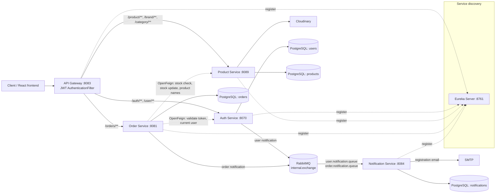

# SwiftShop — E-commerce Microservices (Backend)

Backend of **SwiftShop**, a distributed e-commerce application built as a set of Spring Boot microservices behind a Spring Cloud API Gateway, with Eureka service discovery, OpenFeign for synchronous calls and RabbitMQ for asynchronous notifications.

> **Academic team project.** SwiftShop was built in 2024 by a team of INSAT software engineering students as part of the *Personal and Professional Project (PPP)* course. It is a learning project, not a production system.

| Repository | Content |
|---|---|
| [SwiftShop-Microservices](https://github.com/SAHNOUN-HOUSSEM/SwiftShop-Microservices) | Project overview |
| **PPP_E-commerce_microservices_Backend** (this repository) | Spring Boot microservices |
| [PPP_E-commerce_microservices_Frontend](https://github.com/SAHNOUN-HOUSSEM/PPP_E-commerce_microservices_Frontend) | React + TypeScript storefront |

## Purpose

The project's goal was to design and build an online shop as independent services rather than a single application, and to practise the patterns that come with that: an API gateway, service discovery, inter-service calls, asynchronous messaging, token-based authentication and a database per service.

## Main features

- **Accounts**: registration, login and profile update; passwords stored as BCrypt hashes.
- **JWT authentication**: login returns a signed token that the gateway checks on protected routes.
- **Catalog**: products, brands and categories with pagination and sorting, products by brand, and products by category with search.
- **Product images**: uploaded to Cloudinary when a product, brand or category is created.
- **Orders**: stock check before an order is accepted, stock decrement after it is saved, and order history (own orders for users, all orders for admins).
- **Notifications**: registration and order events published to RabbitMQ and stored by the notification service, which also attempts a registration email.
- **Admin dashboard** (in the frontend): catalog and user management screens shown to `ADMIN` accounts.
- **Tracing**: the services are configured with Spring Cloud Sleuth and Zipkin (end-to-end tracing has not been verified).

## Technologies

| Area | Technology |
|---|---|
| Language | Java 17 |
| Framework | Spring Boot 2.5.7, Spring Cloud 2020.0.3 |
| Edge & discovery | Spring Cloud Gateway, Netflix Eureka |
| Synchronous calls | Spring Cloud OpenFeign (load-balanced through Eureka) |
| Messaging | RabbitMQ (Spring AMQP, topic exchange) |
| Security | Spring Security, JWT (jjwt 0.11.5, HS256), BCrypt |
| Persistence | Spring Data JPA, Hibernate, PostgreSQL |
| Tracing | Spring Cloud Sleuth + Zipkin |
| Media | Cloudinary (product, brand and category images) |
| Email | Spring Mail (registration confirmation) |
| Build | Maven multi-module |
| Local infrastructure | Docker Compose (PostgreSQL, pgAdmin, RabbitMQ, Zipkin) |

## Architecture



Solid arrows show HTTP routing, messaging and data access. Dotted arrows show OpenFeign calls and Eureka registration. The services are also configured to send traces to Zipkin; that isn't drawn, and end-to-end tracing has not been verified.

## Modules and services

| Module | Port | Responsibility |
|---|---|---|
| `eureka-server` | 8761 | Service registry. All other services register here and are resolved by name (`lb://...`). |
| `api-gateway` | 8083 | Single entry point. Routes requests by path, validates the JWT signature on protected routes, configures CORS. |
| `auth-service` | 8070 | Registration, login and JWT issuing; user profile (`/user`). Publishes a user notification to RabbitMQ on registration. |
| `product-service` | 8089 | Products, brands and categories, image upload to Cloudinary, stock checks and stock updates for orders. |
| `order-service` | 8081 | Order placement and order history. Checks and updates stock through the product service, then publishes an order notification. |
| `notification-service` | 8084 | Consumes RabbitMQ notifications, stores them, and attempts a registration confirmation email. |
| `clients` | — | Shared library: OpenFeign clients (`AuthClient`, `ProductClient`), shared DTOs and RabbitMQ exchange/queue/binding configuration. |
| `amqp` | — | Shared library: RabbitMQ configuration and a generic `RabbitMQMessageProducer`. |
| `user-service` | — | Legacy module containing only a `pom.xml`. User management lives in `auth-service`. |

### Gateway routes

Taken from `api-gateway/src/main/resources/application.yml`:

| Path | Target service | JWT filter |
|---|---|---|
| `/auth/**` | `AUTH-SERVICE` | yes (public routes excepted) |
| `/user/**` | `AUTH-SERVICE` | yes |
| `/product/**`, `/brand/**`, `/category/**` | `PRODUCT-SERVICE` | yes (public routes excepted) |
| `/orders/**` | `ORDER-SERVICE` | no gateway filter; the order service validates the token itself through the auth service |

### REST endpoints

| Service | Endpoints |
|---|---|
| Auth | `POST /auth/register`, `POST /auth/login`, `POST /auth/validate`, `POST /auth/getUserId`, `POST /auth/me`, `GET /auth/test` |
| User (auth service) | `GET /user`, `GET /user/{id}`, `PUT /user` |
| Product | `GET /product`, `GET /product/{id}`, `POST /product` (multipart), `PUT /product/{id}`, `DELETE /product/{id}`, `POST /product/lists`; internal: `POST /product/ids`, `POST /product/names`, `POST /product/update` |
| Brand | `GET /brand`, `GET /brand/{id}`, `GET /brand/{id}/products`, `POST /brand` (multipart), `PUT /brand/{id}`, `DELETE /brand/{id}` |
| Category | `GET /category`, `GET /category/{id}`, `GET /category/{id}/products`, `POST /category` (multipart), `PUT /category/{id}`, `DELETE /category/{id}` |
| Order | `GET /orders`, `POST /orders`, `GET /orders/test` |

## Authentication and authorization

- **Login and registration**: `auth-service` stores users with BCrypt-hashed passwords. On login it issues an **HS256 JWT** containing the username (`sub`) and a `userId` claim, valid for **4 hours**.
- **Gateway check**: the gateway's `AuthenticationFilter` requires a `Bearer` token on every non-public route and validates its signature locally. Public routes (`RouteValidator`) are login, registration, token validation, `/auth/me`, and the `GET` endpoints for products, brands and categories.
- **Roles**: users have a role, `USER` or `ADMIN`. The order service fetches the current user from `auth-service` (`/auth/me` via OpenFeign) and returns only the caller's own orders to `USER` accounts and all orders to `ADMIN` accounts. The frontend shows the admin dashboard only to `ADMIN` accounts.
- Authorization in the backend is limited; see the *Security* notice under *Known limitations*.

## Inter-service communication

**Synchronous (OpenFeign through Eureka)**

- `order-service` → `auth-service`: validate the token and load the current user.
- `order-service` → `product-service`: check stock for the ordered products (`/product/ids`), decrement stock (`/product/update`) and resolve product names for order history (`/product/names`).

**Asynchronous (RabbitMQ)**

| Producer | Exchange | Routing key | Queue | Consumer action |
|---|---|---|---|---|
| `auth-service` (on registration) | `internal.exchange` (topic) | `internal.user.notification.routing-key` | `user.notification.queue` | Save notification; attempt registration email |
| `order-service` (after order placement) | `internal.exchange` (topic) | `internal.order.notification.routing-key` | `order.notification.queue` | Save notification |

### Order placement flow

1. The order service validates the token through the auth service.
2. It asks the product service whether every product is in stock and rejects the order if not.
3. It saves the order and its items.
4. It asks the product service to decrement stock.
5. It publishes an order notification to RabbitMQ.

These steps are not wrapped in a distributed transaction. See *Known limitations*.

## Database architecture

Each service owns its own PostgreSQL database (*database per service*). Schemas are generated by Hibernate (`ddl-auto`).

| Service | Database | Main entities |
|---|---|---|
| auth-service | `users` | `AppUser` (role `USER`/`ADMIN`) |
| product-service | `products` | `Product`, `Brand`, `Category` (a product belongs to one brand and one category) |
| order-service | `orders` | `Order`, `OrderItem` (an order item references a product by ID) |
| notification-service | `notifications` | `Notification` |

Services never read another service's tables; cross-service data goes through OpenFeign.

## Running locally

> **What has been verified.** On JDK 17, the build succeeds after the local `sse-service` workaround (step 3), the Eureka server starts with the command in step 4, and the external configuration method in step 2 is picked up by a service started that way. Running the other services, the Docker Compose infrastructure and the end-to-end flows has not been verified.

### Prerequisites

- **JDK 17.** Compilation fails on JDK 21 because the project's Lombok version is too old.
- Maven 3.8+
- Docker with Docker Compose
- A Cloudinary account, for image upload in the product service
- Optional: SMTP credentials, for registration emails

### 1. Start the infrastructure

```bash
docker compose up -d
```

Docker Compose runs **infrastructure only**: PostgreSQL (`5432`), pgAdmin (`5050`), RabbitMQ (`5672`, management UI on `15672`) and Zipkin (`9411`). The Spring Boot services are not containerized; they run on the host (step 4).

The Compose file creates only one database. Create the four service databases yourself:

```bash
docker exec -it example-database psql -U example-database -c "CREATE DATABASE users;"
docker exec -it example-database psql -U example-database -c "CREATE DATABASE products;"
docker exec -it example-database psql -U example-database -c "CREATE DATABASE orders;"
docker exec -it example-database psql -U example-database -c "CREATE DATABASE notifications;"
```

The database user and password in each `application.yml` are local development defaults matching `docker-compose.yml`.

### 2. Configure

Each module reads its configuration from `src/main/resources/application.yml`. The product service needs **your own** Cloudinary credentials (`cloudinary.cloud_name`, `cloudinary.api_key`, `cloudinary.api_secret`). The Cloudinary credentials that appear in the repository's history have been revoked and no longer work.

**Keep secrets out of Git, shell history and command lines.** Do not commit them, write them into this or any other documentation, type them as part of a command, or pass them as process arguments.

The recommended local method uses standard Spring Boot external configuration and needs no code change. Keep the secrets in a file **outside the repository**, and point the service at it with `SPRING_CONFIG_ADDITIONAL_LOCATION`. Values in that file override the ones in `application.yml`.

1. Create a file outside the repository, for example `C:\Users\<you>\swiftshop-local\product-service.yml`, and fill it in with a text editor:

   ```yaml
   cloudinary:
     cloud_name: <your-cloud-name>
     api_key: <your-api-key>
     api_secret: <your-api-secret>
   ```

2. In the terminal that will start the product service, set the variable to the file's **path** (the path is not a secret):

   ```powershell
   # PowerShell
   $env:SPRING_CONFIG_ADDITIONAL_LOCATION = "file:C:/Users/<you>/swiftshop-local/product-service.yml"
   ```

   ```bash
   # Bash / Git Bash
   export SPRING_CONFIG_ADDITIONAL_LOCATION="file:C:/Users/<you>/swiftshop-local/product-service.yml"
   ```

3. Start the product service from that terminal (step 4).

The same method works for the optional SMTP settings of `notification-service` (`spring.mail.username`, `spring.mail.password`, Gmail SMTP by default); use a separate file for that service. See *Known limitations* about the email code.

Spring Boot also reads environment variables such as `CLOUDINARY_API_KEY`. However, typing a value into an `export` or `$env:` command stores it in your shell history, which is why the file method is recommended.

### 3. Build

The parent `pom.xml` lists an `sse-service` module that is not in the repository, so the published source does not build as-is. As a **temporary local workaround**, delete the line `<module>sse-service</module>` from the root `pom.xml` in your local copy. This change is not part of the repository; don't commit it. Then build and install the modules (the services depend on the shared `clients` and `amqp` modules):

```bash
mvn clean install -DskipTests
```

### 4. Start the services

The build produces plain JARs, not executable Spring Boot JARs (the Spring Boot Maven plugin is declared but not applied), so `java -jar` does not work. Start each service with the Spring Boot Maven plugin, Eureka first, each in its own terminal:

```bash
mvn -pl eureka-server org.springframework.boot:spring-boot-maven-plugin:2.5.7:run
mvn -pl auth-service org.springframework.boot:spring-boot-maven-plugin:2.5.7:run
mvn -pl product-service org.springframework.boot:spring-boot-maven-plugin:2.5.7:run
mvn -pl order-service org.springframework.boot:spring-boot-maven-plugin:2.5.7:run
mvn -pl notification-service org.springframework.boot:spring-boot-maven-plugin:2.5.7:run
mvn -pl api-gateway org.springframework.boot:spring-boot-maven-plugin:2.5.7:run
```

Start the product service from the terminal where `SPRING_CONFIG_ADDITIONAL_LOCATION` is set (step 2). You can also run each service's `*Application` class from an IDE; set the same environment variable in the run configuration.

- Eureka dashboard: http://localhost:8761
- API Gateway: http://localhost:8083

## Testing

The repository has **no automated tests**. `mvn test` completes with "No tests to run" for every module.

## Known limitations

This is an academic project and is **not production-ready**.

> **Security:** This academic project has known limitations in authentication, authorization, sensitive-data handling, input validation and logging. It has not undergone production security hardening. Do not deploy it to an untrusted network or use it with real user data.

- **Build and run setup.** The parent `pom.xml` references a missing `sse-service` module, so the published source needs the temporary local workaround described in *Running locally* to build. The build also produces non-executable JARs, so services are started with the Spring Boot Maven plugin instead of `java -jar`.
- **No automated tests.** The repository contains no unit or integration tests.
- **Infrastructure only in Docker.** Docker Compose runs infrastructure only; the Spring Boot services have no Dockerfiles. The repository contains **no Kubernetes manifests**.
- **Manual database setup.** The four service databases must be created by hand.
- **No distributed transaction for orders.** Order placement saves the order, updates stock and publishes a notification as separate steps, so a failure between steps can leave data inconsistent. There is no saga or outbox.
- **Registration email.** The email code loads a `.env` file at send time and sets an empty sender address, so registration emails are not expected to work as written.
- **Leftovers.** `user-service` is an empty legacy module.

## Team

Academic team project by INSAT software engineering students. Contributors, from the repository history:

- [SAHNOUN-HOUSSEM](https://github.com/SAHNOUN-HOUSSEM)
- FkihMehdi
- L2RR2L
